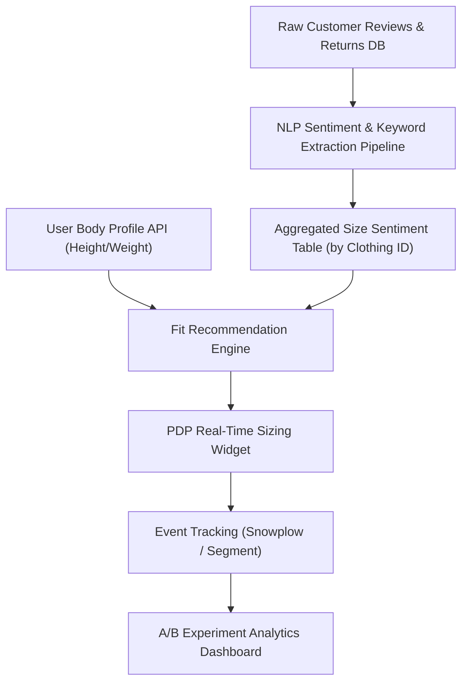

# Product Requirements Document (PRD)
## Smart Size & Fit Guidance — PDP Interactive Intelligence Module

| Document Attribute | Specification |
|:---|:---|
| **Feature Name** | Smart Size & Fit Guidance Assistant |
| **Product Surface** | Web & Mobile Product Detail Page (PDP) |
| **Document Status** | Approved for Execution (Ready for Engineering) |
| **Version** | v1.0.0 |
| **Lead Product Manager** | Senior Product Manager, Core Commerce & Retention |
| **Lead Data Scientist** | Staff Product Analytics Engineer |
| **Target Release Quarter** | Q3 2026 |

---

## 1. Executive Summary & Problem Validation

### 1.1 The Business Problem
In e-commerce fashion retail, reverse logistics and customer returns represent the single largest erosion of unit economics and contribution margins. Apparel returns average between **24% and 30%** industry-wide, with reverse shipping, warehouse inspection, steaming, and markdown devaluation costing upwards of **$15.00 per returned unit**.

Furthermore, fit-related friction drives high cart abandonment, customer support volume, and "bracketing" behavior—where shoppers deliberately purchase multiple sizes (e.g., both Medium and Large) intending to return all but one.

### 1.2 Quantitative Data Evidence (Empirical Review Analysis)
An exhaustive SQL and natural-language analysis of **23,486 verified customer reviews** from the Women's E-Commerce Clothing catalog reveals that customer dissatisfaction is overwhelmingly concentrated around sizing ambiguity rather than fabric quality or delivery delays:

* **Overall Catalog Sentiment Baseline**:
  * Total Reviews Analyzed: **23,486**
  * Average Catalog Rating: **4.20 / 5.00**
  * Catalog Recommendation Rate: **82.24%**
  * Negative Review Share (Rating $\le$ 2 Stars): **10.25%** (**2,407 reviews**)
* **The Fit Dissatisfaction Crisis**:
  * **76.40%** of all negative reviews (**1,839 out of 2,407**) explicitly cite size, fit, tight/loose silhouettes, length discrepancies, or return friction as their primary dissatisfaction driver.
  * More than 3 out of every 4 dissatisfied shoppers rated an item 1 or 2 stars solely because it did not fit as expected.
* **Root-Cause Sub-Classification (Inside Negative Reviews)**:
  * **Proportion & Length Discrepancies**: **44.04%** (1,060 reviews) — Customers report dresses that drag or hike up awkwardly, unaccommodating bust/armhole cuts, and ill-positioned waistbands.
  * **Runs Small / Severe Tightness**: **27.21%** (655 reviews) — Customers find garments unwearably tight in the torso, shoulders, and chest.
  * **Runs Large / Baggy Silhouette**: **26.42%** (636 reviews) — Garments fit shapelessly or require stepping down 1–2 sizes.
* **Department & Category Vulnerabilities**:
  * **Dresses**: Highest aggregate volume of fit pain points (**546 fit complaints**, accounting for **79.25%** of all negative dress reviews; 6,319 total reviews, 10.90% negative rate).
  * **Trend**: Highest overall negative review rate at **18.49%** (avg rating 3.82, rec rate 73.95%, with **77.27%** of negative reviews citing sizing failure).
  * **Tops & Blouses**: Blouses exhibit an **11.24%** negative rate across 3,097 reviews, with shoulders and chest tightness being primary triggers.
* **Demographic Cohort Vulnerability**:
  * **Age Cohort 26–35** is the single worst-performing demographic cohort:
    * Negative Review Rate: **11.39%** (highest across all cohorts)
    * Average Rating: **4.14 / 5.00**
    * Recommendation Rate: **79.89%**
    * Size/Fit Complaint Share in Negatives: **79.54%** (almost 80% of dissatisfied young professional shoppers cite sizing failure).

---

## 2. Business Opportunity & Financial ROI Projection

### 2.1 Unit Economics Model ($25,000,000 GMV Baseline)
To demonstrate the commercial imperative of eliminating size uncertainty on the PDP, we model a mid-tier apparel brand with **$25,000,000 in annual GMV**:

* **Average Order Value (AOV)**: $115.00
* **Total Annual Orders**: $\approx 217,391$ orders
* **Baseline Overall Return Rate**: 28.0% ($\approx 60,870$ returns/year)
* **Size/Fit Return Share**: 71.2% ($\approx 43,339$ returns driven by fit)
* **Reverse Logistics & Reprocessing Cost**: $15.00 / return
* **Target Size-Related Return Reduction**: **20.0%** (via PDP Guidance)

### 2.2 Projected Annual Financial Impact
* **Avoided Return Shipments**: **8,668 returned units saved per year**
* **Direct Reverse Logistics Savings**: $8,668 \times \$15.00 = \mathbf{\$130,020\text{ / year}}$
* **Retained Net Merchandise Sales**: $8,668 \times \$115.00 = \mathbf{\$996,820\text{ / year}}$
* **Projected Platform Return Rate**: Decreases from **28.00% down to 24.01%** (-3.99 percentage points overall).

---

## 3. Target User Personas & Jobs-to-be-Done (JTBD)

### Persona 1: Maya — "The Hesitant First-Time Shopper"
* **Demographics**: Age 29, Digital Marketing Specialist, purchases online 2–3 times a month.
* **Pain Point**: Finds a dress she loves for a summer wedding, but has been burned by vanity sizing across different brands. She is unsure whether to pick Size 6 or Size 8.
* **JTBD**: *"When I am considering a new dress on an unfamiliar platform, I want clear, crowd-sourced validation of whether it runs small or large, so that I can order the right size on the first try without fear of an inconvenient return cycle."*

### Persona 2: Claire — "The Multi-Size Bracketing Buyer"
* **Demographics**: Age 42, Corporate Director, mother of two, high discretionary spend.
* **Pain Point**: Time-poor; cannot afford to receive a garment that doesn't fit right before a business trip. Orders both Medium and Large, keeping one and sending the other back.
* **JTBD**: *"When I am shopping for workwear trousers and blazers, I want personalized size recommendations based on my exact measurements, so that I only need to buy one item rather than tying up capital in multi-size bracketing."*

### Persona 3: Elena — "The Proportion-Sensitive Shopper"
* **Demographics**: Age 54, loyal customer, values garment drape and torso length.
* **Pain Point**: Frequently finds that dresses fit her chest but are either 3 inches too long or cinch uncomfortably high on the ribcage.
* **JTBD**: *"When I am browsing midi dresses, I want to see how the hemline and waistline sit on customers with my specific height and body shape, so that I don't receive an item with disproportionate tailoring."*

---

## 4. Product Solution: Smart Size & Fit Guidance PDP Module

The proposed solution replaces the generic, static alphanumeric PDF size chart with an interactive, contextual **Smart Size & Fit Recommender** embedded directly above the "Add to Bag" CTA.

```
+-----------------------------------------------------------------------+
|  [PRODUCT IMAGE]           CLASSIC FLORAL SILK DRESS                  |
|                            $138.00 | ★★★★☆ 4.2 (184 reviews)           |
|                                                                       |
|                            FIT CONSENSUS GAUGE                        |
|                            Runs Small  [--●-------]  Runs Large       |
|                            (68% report True to Size | 24% Runs Small)  |
|                                                                       |
|                            +-------------------------------------+    |
|                            | 📐 What's My Size? (1-Click Advisor)|    |
|                            | Recommended: Size 6 (88% fit match) |    |
|                            +-------------------------------------+    |
|                                                                       |
|                            SELECT SIZE:                               |
|                            [ 2 ]  [ 4 ]  [ (6) ]  [ 8 ]  [ 10 ]       |
|                                                                       |
|                            [       ADD TO BAG - $138.00       ]       |
+-----------------------------------------------------------------------+
```

### 4.1 Functional Requirements Matrix

| ID | Feature Name | Priority | User Story | Acceptance Criteria |
|:---|:---|:---:|:---|:---|
| **FR-01** | **Consensus Fit Slider** | **P0** | As a shopper, I want to see an aggregated fit meter (Runs Small / True to Size / Runs Large) based on verified buyer reviews. | 1. Calculate sentiment across all reviews for this `Clothing ID`.<br>2. Render horizontal gauge with markers.<br>3. Display tooltip with exact percentages (e.g., "72% True to Size"). |
| **FR-02** | **1-Click Fit Predictor Modal** | **P0** | As a shopper, I want to input my height, weight, and fit preference to get an instant size suggestion. | 1. Lightweight 3-field modal (Height, Weight, Preferred Fit: Tight/Regular/Loose).<br>2. Output recommended size with confidence rating.<br>3. Persist profile in `localStorage` / user account for 1-click recommendations on subsequent PDP visits. |
| **FR-03** | **Proportion & Length Tagging** | **P1** | As a shopper, I want to know if a dress or pant runs particularly long, short, or tight in the bust. | 1. Surface automated badge warnings: e.g., *"⚠️ Length Alert: 44% of shoppers note this style runs long"*. |
| **FR-04** | **Filter Reviews by Body Twin** | **P1** | As a shopper, I want to filter the customer reviews tab to only see feedback from customers of similar age, height, and size. | 1. Provide filter chips: "Customers who wear Size M", "Age 26-35", "Height 5'3\"-5'6\"".<br>2. Re-render review stream dynamically without page reload. |
| **FR-05** | **Garment Dimension Blueprint** | **P2** | As an exacting buyer, I want exact flat-lay garment measurements (bust circumference, waist, shoulder seam, total length). | 1. Expandable technical measurement drawer with annotated CAD illustration. |

---

## 5. Technical Architecture & Data Pipeline



### 5.1 Data Ingestion & Scoring Logic
1. **Keyword Tagger**: Background batch job parses incoming customer review titles and body text against dictionary regular expressions:
   * `Small / Tight`: `['tight', 'runs small', 'too small', 'snug', 'squeeze']` $\rightarrow$ Score: -1.0
   * `True to Size`: `['true to size', 'fits perfectly', 'great fit', 'as expected']` $\rightarrow$ Score: 0.0
   * `Large / Loose`: `['runs large', 'too big', 'baggy', 'huge', 'swimming']` $\rightarrow$ Score: +1.0
2. **Aggregated Consensus Calculation**:
   $$\text{Fit Index} = \frac{\sum (\text{Tag Scores})}{\text{Total Tagged Reviews}}$$
3. **Latency SLA**: Client-side widget must load in $\le 85\text{ ms}$ via CDN edge caching; no blocking of PDP Time-to-Interactive (TTI).

---

## 6. Success Metrics & Guardrail KPIs

### 6.1 Primary Success Metric (North Star)
* **Size-Related Return Rate**:
  * **Baseline**: 20.0% of all apparel orders returned due to size.
  * **Target**: **-15.0% to -20.0% reduction** ($p < 0.01$).

### 6.2 Secondary & Evaluative Metrics
* **Add-to-Bag (ATB) Rate**: Target **+3.5% uplift** (reducing hesitation at size selector).
* **Multi-Size "Bracketing" Rate**: Target **-30% reduction** in transactions containing duplicate items in adjacent sizes.
* **Fit Satisfaction CSAT**: Post-purchase 14-day survey question: *"How did the item fit?"* — Target **+12% increase** in "Fits as expected".

### 6.3 Guardrail Metrics (Zero-Harm Thresholds)
* **PDP-to-Checkout Conversion Rate (CVR)**: Guardrail: Non-inferiority ($\Delta \ge 0.0\%$, $\alpha = 0.05$). The guidance widget must not add cognitive friction that depresses checkout intent.
* **PDP Page Load Latency**: Guardrail: 95th percentile latency must remain under **1.8 seconds**.

---

## 7. A/B Testing & Experimentation Roadmap

### 7.1 Experiment Setup
* **Target Audience**: 100% of US/CA Web & Mobile Web traffic visiting apparel PDPs (`Dresses`, `Tops`, `Jackets`, `Bottoms`).
* **Randomization Unit**: User Cookie / Persistent Session ID (50/50 split).

| Variant | Experience Description |
|:---|:---|
| **Control (A)** | Standard PDP with static alphanumeric size guide modal. |
| **Treatment (B)** | PDP with Smart Size & Fit Guidance Widget (Consensus Fit Slider + 1-Click Body Profile Predictor + Proportion Alerts). |

### 7.2 Power Analysis & Sample Sizing
* **Baseline Size-Return Rate ($p_1$)**: 20.0%
* **Minimum Detectable Effect (MDE)**: 1.5 percentage points relative reduction (down to 18.5%).
* **Statistical Power ($1 - \beta$)**: 80% ($\beta = 0.20$).
* **Significance Level ($\alpha$)**: 5% two-tailed ($\alpha = 0.05$).
* **Required Sample Size**: Minimum **28,500 unique purchasing sessions per variant** ($\approx 57,000$ total purchasers).
* **Experiment Duration**: **4 weeks minimum**. This ensures full coverage of the purchase $\rightarrow$ fulfillment $\rightarrow$ 30-day return window lifecycle.

### 7.3 Decision Rules
* **Ship Condition**: Treatment exhibits statistically significant reduction in Size Return Rate ($p < 0.05$) while Conversion Rate CVR is neutral or positive.
* **Stop / Kill Condition**: If Treatment causes a statistically significant drop in PDP-to-Cart Conversion Rate ($> 1.0\%$ decline with $p < 0.01$) over 7 consecutive days, pause experiment immediately.

---

## 8. Rollout Plan & Post-Launch Monitoring

1. **Phase 1: Internal Dogfooding (Week 1)**: Deploy to internal employee sessions and beta testing panel.
2. **Phase 2: 10% Canary Pilot (Week 2)**: Deploy to 10% of Dress category shoppers (highest pain point segment). Validate event telemetry.
3. **Phase 3: 50/50 A/B Test Execution (Weeks 3–6)**: Full 4-week test execution with weekly KPI tracking.
4. **Phase 4: 100% General Availability (GA) (Week 7)**: Transition 100% of traffic to Treatment if ship criteria are met.
5. **Phase 5: Automated Feedback Loop**: Feed return reason codes back into the ML recommender to dynamically recalibrate size suggestions.

