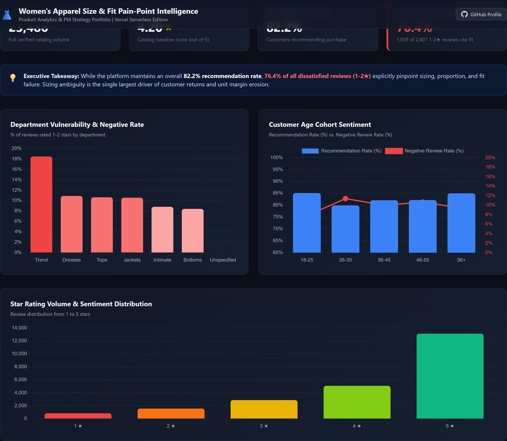
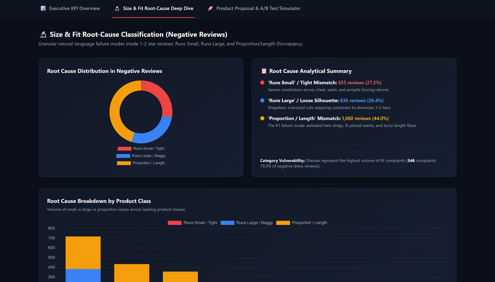
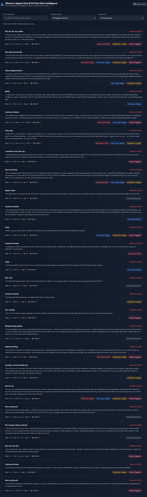
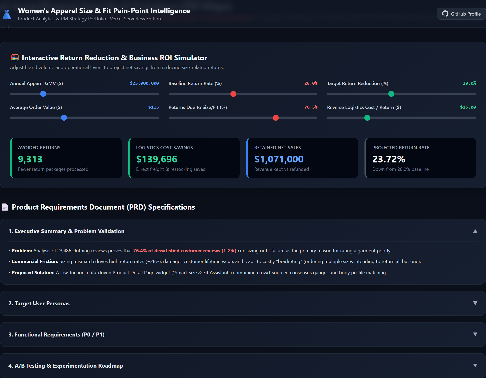

# 👗 Size & Fit Pain-Point Analysis — Fashion Reviews
### End-to-End Product Analytics & PM Strategy Portfolio

[](https://www.python.org/)
[](https://streamlit.io/)
[](https://plotly.com/)
[](https://www.sqlite.org/)
[](LICENSE)

🌐 **Live Interactive Dashboard:** https://fashion-size-fit-analysis.vercel.app/

An end-to-end Product Analytics & Product Management (PM) case study analyzing **23,486 customer reviews** from the Women's E-Commerce Clothing dataset. This project quantifies the business impact of sizing uncertainty, pinpoints category and demographic vulnerability, and presents a comprehensive Product Requirements Document (PRD) and interactive Streamlit decision dashboard for a **"Smart Size & Fit Guidance"** PDP module.

---

## 📌 Executive Summary & Key Findings

While the e-commerce platform exhibits an overall healthy **4.20 / 5.00** rating and an **82.24%** recommendation rate, granular SQL analysis of dissatisfied customers reveals that **sizing and fit friction is the overwhelming driver of product returns and low ratings**:

| Metric | Empirical Analysis Result | Product & Operational Takeaway |
|:---|:---:|:---|
| **Total Analyzed Reviews** | **23,486** | Verified women's apparel customer reviews across 6 departments. |
| **Overall Average Rating** | **4.20 / 5.0** | High satisfaction ceiling; issues are concentrated in specific silos. |
| **Customer Recommendation Rate** | **82.24%** | Baseline brand loyalty remains strong. |
| **Negative Reviews (Rating $\le$ 2)** | **2,407 (10.25%)** | Primary source of customer churn and reverse logistics cost. |
| **Negative Reviews Citing Size/Fit** | **1,839 of 2,407 (76.40%)** | **Over 3 in 4 bad reviews stem from sizing/fit failure**, not material or shipping. |
| **Proportion / Length Mismatch** | **44.04%** (1,060 reviews) | The #1 failure mode: awkward hemlines, unaccommodating torsos, and bust cuts. |
| **Runs Small / Tight Fit** | **27.21%** (655 reviews) | Constriction in chest, waist, and armpits forcing returns. |
| **Runs Large / Loose Fit** | **26.42%** (636 reviews) | Shapeless cuts prompting customers to re-order 1-2 sizes down. |
| **Top Category by Fit Complaint Volume** | **Dresses** (546 fit complaints) | **79.25% of negative dress reviews cite fit** (6,319 total reviews). |
| **Highest Negative Rate Category** | **Trend** (18.49% negative) | High-fashion items have extreme sizing variance and 77.27% fit complaints. |
| **Worst-Performing Age Segment** | **Age 26–35** (11.39% neg rate) | 4.14 avg rating; **79.54% of negative reviews cite sizing mismatches**. |

---

## 🖼️ Dashboard Preview & Visual Gallery

### Tab 1: Executive KPI Overview
*Real-time executive metric cards, department vulnerability rankings, age cohort sentiment trends, and star rating volume distribution.*



---

### Tab 2: Size & Fit Root-Cause Deep Dive
*Granular failure mode classification (Runs Small vs. Runs Large vs. Proportion/Length) and product class vulnerability.*



---

### Searchable Customer Voice & Review Explorer
*Inspect real customer reviews with dynamic root cause pills and return trigger flags.*



---

### Tab 3: Product Proposal & A/B Experiment Simulator
*Interactive ROI model quantifying avoided return packages, reverse logistics cost savings, retained merchandise value, and PRD specifications.*



---

## 🏗️ Repository Architecture

```
fashion-size-fit-analysis/
├── assets/                       # High-resolution application screenshots
│   ├── 01_executive_kpi_overview.png
│   ├── 02_root_cause_deepdive.png
│   ├── 03_customer_review_explorer.png
│   └── 04_product_proposal_simulator.png
├── data/
│   └── reviews.csv               # 23,486 verified clothing reviews (auto-downloaded)
├── sql/
│   └── analysis_queries.sql      # Production-grade SQLite analytical queries
├── download_data.py              # Automated data ingestion & validation script
├── project1_numbers.py           # In-memory SQLite analytics engine & CLI summary
├── PRD_Size_Fit_Guidance.md      # Product Requirements Document for PDP Sizing Feature
├── app.py                        # 3-tab interactive Streamlit analytics & simulator app
├── requirements.txt              # Core project dependencies
├── .gitignore                    # Standard Python & environment exclusions
└── README.md                     # Portfolio documentation & setup guide
```

---

## 🚀 Quickstart & Setup Guide

### 1. Clone & Set Up Environment
```bash
git clone <repository_url>
cd fashion-size-fit-analysis

# Create and activate virtual environment (optional)
python -m venv venv
# On Windows:
venv\Scripts\activate
# On macOS/Linux:
source venv/bin/activate
```

### 2. Install Dependencies
```bash
pip install -r requirements.txt
```

### 3. Automatically Download Dataset
Run the automated downloader to fetch and verify the 23,486-row dataset:
```bash
python download_data.py
```
*Output:*
```
Attempting download from: https://raw.githubusercontent.com/...
Successfully downloaded raw data
Verifying and formatting dataset...
Total row count: 23486
SUCCESS: Saved verified dataset with 23486 rows and 10 columns to data/reviews.csv
```

### 4. Execute Analysis & View CLI Metrics
Run the SQLite analysis engine to print the exact numbers:
```bash
python project1_numbers.py
```

### 5. Launch the Interactive Streamlit Dashboard
```bash
streamlit run app.py
```
Open your browser at `http://localhost:8501` to access the 3 interactive tabs.

### 6. Run FastAPI Serverless App Locally (Vercel Mode)
You can also run the high-performance FastAPI backend & single-page application locally:
```bash
uvicorn api.index:app --reload --port 8000
```
Open your browser at `http://localhost:8000` for the full Tailwind CSS + Chart.js SPA dashboard, or query the REST endpoints:
* `GET /api/metrics`: Full catalog KPIs, department breakdowns, age cohorts, and root causes JSON.
* `GET /api/reviews?department=Dresses&cause=small`: Filtered negative review explorer JSON.

---

---

## 💻 SQL Analysis Highlights (`sql/analysis_queries.sql`)

The repository includes well-commented SQLite queries powering the data pipeline:
* **`Q1_OVERALL_KPIS`**: Computes catalog-level volume, average ratings, and recommendation rates.
* **`Q2_DEPARTMENT_PERFORMANCE`**: Evaluates ratings and negative review shares across all 6 departments.
* **`Q4_AGE_COHORT_PERFORMANCE`**: Groups customers into 5 age cohorts (18-25, 26-35, 36-45, 46-55, 56+) to uncover demographic variance.
* **`Q5_SIZE_FIT_COMPLAINT_SHARE`**: Filters dissatisfied reviews (Rating $\le$ 2) and identifies size/fit keywords (`size`, `fit`, `tight`, `loose`, `small`, `large`, `length`, `short`, `waist`, `bust`, `return`, etc.).
* **`Q6_ROOT_CAUSE_BREAKDOWN`**: Classifies fit complaints into 3 distinct operational modes ("Runs Small", "Runs Large", "Proportion/Length").
* **`Q7_CATEGORY_SIZE_FIT_VULNERABILITY`**: Computes category-level fit complaint density per 1,000 orders.

---

## 📄 Product Requirements Document (PRD) Overview

Read the full document: [PRD_Size_Fit_Guidance.md](PRD_Size_Fit_Guidance.md)

### Proposed Feature: Smart Size & Fit Guidance PDP Module
* **Problem**: 76.40% of negative reviews are caused by sizing uncertainty, driving high apparel return rates (~28%) and "multi-size bracketing".
* **Solution**:
  1. **Consensus Fit Gauge (P0)**: Real-time slider aggregating verified customer feedback ("Runs Small", "True to Size", "Runs Large").
  2. **1-Click Fit Predictor (P0)**: Modal recommending optimal size based on customer height, weight, and preferred fit.
  3. **Proportion Alerts (P1)**: Contextual warnings for garments with high hemline or bust variance.
  4. **Filter Reviews by Body Twin (P1)**: Review filtering by customer height, weight, and age cohort.
* **A/B Testing Plan**:
  * **Design**: 50/50 randomized split across Web/Mobile PDPs for 4 weeks.
  * **Primary Success Metric**: Size-Related Return Rate (-15% to -20% target, $p < 0.01$).
  * **Guardrail Metric**: PDP-to-Cart Conversion Rate ($\Delta \ge 0.0\%$).
* **Projected Impact on a $25M GMV Retailer**:
  * **8,668 fewer return packages processed per year**
  * **$130,020 in direct reverse shipping savings**
  * **$996,820 in retained sales value**

---

## 👩‍💻 Author & Contact

**Product Analytics & PM Strategy Portfolio Project**  
*Built with Python, Streamlit, Plotly, SQLite, and Markdown.*
